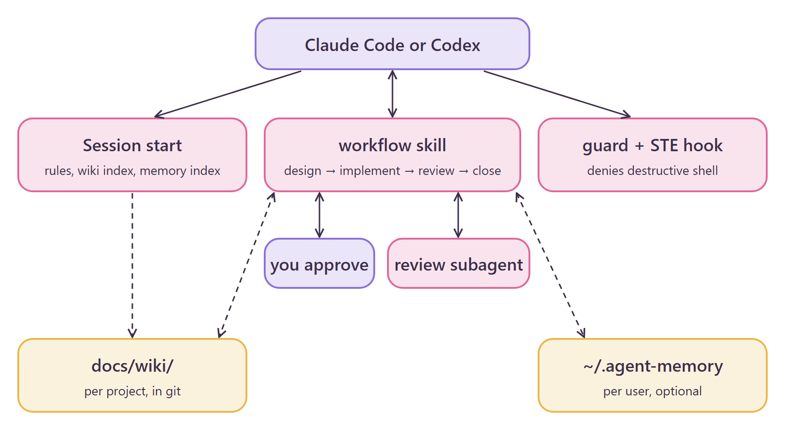

<div align="center">

# minimal-agent-kit

**A small, token-cheap rule kit that keeps coding agents careful and honest**

English · [简体中文](README.zh-CN.md) · [繁體中文](README.zh-TW.md)

`minimal-agent-kit` 

</div>

## What is this?

`minimal-agent-kit` gives Claude Code and Codex one workflow, one memory model, and one safety net.

- **Rules and skills**: a design, implement, review, and close workflow, with two human approval gates, BDD scenarios, and a Graphviz diagram.
- **Hooks**: a guard that denies or asks about destructive shell commands, also in bypass mode, and a check for Simplified Technical English (STE).
- **Checks**: scripts that test the JSON plan and the changed Python and JS code against it. A reusable sandbox tests risky assumptions before you write code.

You see the rules and your project wiki index at the start of each session. Then the agent asks you questions before it writes code.

Guiding question: *what is the minimal amount of code and impact that leads to the solution?*

<p align="center"></p>

## Requirements

- Python 3.9 or later, on `PATH` as `python3` or `python`.
- Graphviz (`dot`), for design diagrams.
- Node 22.18 or later, for the guard hook, the JS checks, the spike sandbox, the optional `agent-memory` plugin, and the lounge core.
- Claude Code, or the Codex app or CLI.
- Windows, for the optional lounge.

## Install (๑•̀ㅂ•́)و✧

### 1. Add the marketplace (Claude Code)

```bash
claude plugin marketplace add stellarie/minimal-agent-kit
```

Claude Code lists the `minimal-agent-kit` marketplace.

### 2. Install the kit (Claude Code)

```bash
claude plugin install minimal-agent-kit@minimal-agent-kit
```

Restart Claude Code. The session context then starts with `# Agent rules`.

### 3. Install the memory plugin (optional)

```bash
claude plugin install agent-memory@minimal-agent-kit
```

After a restart, the session context shows a memory index. The store is `~/.agent-memory`.

### 4. Install for Codex

Codex needs files copied and a hook added to `~/.codex/config.toml`. Follow [INSTALL.md](INSTALL.md). An agent can run it step by step.

### 5. Set up the spike sandbox (optional, once)

```bash
python tools/sandbox.py <empty-dir>
```

The command needs network access. It prints `sandbox ready: <empty-dir>`. Each task then uses a `spike/<task>` branch there.

### 6. Install the lounge (optional, Windows)

```bash
python tools/release.py
```

The command writes two zips to `dist/`: `minimal-agent-kit-<ver>.zip` holds the kit only. `minimal-agent-kit-lounge-<ver>-windows.zip` holds the kit and the lounge. Build the exe, `lounge/ui/dist`, and `lounge/core/node_modules` first, or `release.py` writes only the kit zip. Unzip the lounge zip, then run `lounge/agent-lounge.exe`. The app starts the core beside it. [INSTALL.md](INSTALL.md) lists the build commands.

## Skills and hooks

| Name | Kind | What it does |
|---|---|---|
| `workflow` | skill | Design, implement, review, close. Each phase has numbered substeps and an output template. |
| `wiki` | skill | Keeps long-term project memory in `$WIKI_ROOT/<name>/`, or in `docs/wiki/` when `WIKI_ROOT` is unset. Fixed page format. |
| `ste` | skill | The STE writing rules for chat and files. |
| `style` | skill | Grammar, punctuation, composition, and word-choice rules for docs, comments, and commit text. |
| `verify/` | scripts | Check the plan file, its proofs, and its design diagram, check the changed Python and JS code against the plan, run the project's own check tools, and prove each changed hunk is needed by a test. They also check a wiki folder against the wiki format. |
| `tools/sandbox.py` | script | Sets up a reusable spike sandbox (pytest, jest, Express, React) with fault mocks, once. |
| `SessionStart` | hook | Loads the rules and the wiki `index.md`. |
| `PreToolUse` | hook | Runs the guard on each `Bash` and `PowerShell` call. |
| `PostToolUse` | hook | Runs the STE check on each Markdown file the agent writes. |

A round trip with the guard:

```bash
echo '{"tool_name":"Bash","tool_input":{"command":"rm -rf /"}}' | node claude/guard/guard.js
```

The guard prints a JSON decision with `"permissionDecision":"deny"` and the reason. A safe command, such as `git status`, prints nothing, so the agent keeps its own permission prompts. A risky but common command, such as `git clean -fdx`, gets `"ask"`.

## Lounge (≧∀≦)

The lounge is an optional Windows desktop app. It runs Claude Code and Codex in chat threads, with the same guard. Windows comes first. Claude Code and Codex are the two runtimes. The core needs Node 22.18 or later. See [lounge/docs/architecture.md](lounge/docs/architecture.md).

| Feature | What it does |
|---|---|
| Seeded skills | The first start copies `wiki` and `ste` to `<home>\skills`. A skill that you edit stays as you left it. |
| Kit workflow plugin | The bundled plugin `kit-workflow` adds the full kit workflow skill with its verify scripts. Turn it on in the plugin list. It needs Python 3 on the `PATH`. |
| Models and efforts | The agent editor lists the models and efforts that your Claude Code and Codex installs report, per model, with **Custom…** for any other name. **Refresh** reads them again. |
| Phase gates | The tool `lounge_gate` opens an Approve or Change card at the end of design and review. Your decision wakes the lead agent. |
| Blackboard | The read-only **Board** tab shows the task files in `.kit/tasks/`. |
| Child threads | The tool `lounge_spawn` starts a child thread for an agent in the roster. The depth cap is 2. A stop reaches every child. The agent graph shows the tree. |
| Isolation | A turn loads none of your own skills, plugins, `CLAUDE.md`, or `AGENTS.md`. Codex runs with its own `CODEX_HOME`, and native subagents are off. |
| Codex sign-in | **Sign in to Codex** logs in the lounge copy of Codex. The lounge never copies your `auth.json`. |
| Themes | The theme picker makes custom themes. **Export custom themes** copies them as JSON. **Import themes** adds themes from pasted JSON, up to 30 in all. |
| Updates | The lounge checks GitHub for a release signed with `lounge/update.pub`. A banner asks you first. **Restart to update** swaps the install and rolls back on an error. Your data stays. `update.check` in `config.json` turns the check off. |
| Wiki panel | Lists, reads, and edits wiki pages. Each save shows the wiki check findings. |
| Auto mode | A classifier model judges a mutating call that the rules allow. A rule ask opens an approval card, unless the guard mode below says otherwise. |
| Guard modes | A switch in the app header sets one guard mode for the lounge. **Normal** opens a card for each rule ask. **Auto** sends each rule ask to a Claude judge. An exact SAFE allows it, and any other answer opens a card. **Bypass** allows each rule ask and each tool mode check with no card, until the core restarts. Hard blocks still deny in every mode. Each silent allow is in the guard log. |
| Guard judge | The Permissions view sets the judge model, its effort, and a policy of the cases that you allow or never allow. A default policy ships and you can edit it. |

## Safety (｀ω´)ゞ

The kit does not give the agent new power. The guard only removes power. It does not sandbox the agent.

1. The guard reads the command as tokens and checks each part. It denies these:
   - `rm` on a root, home, or drive path.
   - `git reset --hard`, any force push, and a push to `main` or `master`.
   - `DROP DATABASE` sent to `psql`, `mysql`, `sqlite3`, or `sqlcmd`.
2. It asks about these:
   - `rm -r` outside a scratch folder, and `git clean -f`.
   - Disk tools such as `mkfs`, and `dd` to a device.
   - Encoded or piped shell text.
   - Reads of secret files such as `.env` and `.ssh`.
3. It checks commands inside `sh -c`, `bash -c`, `pwsh -Command`, and similar wrappers again.

An ask opens the normal approval prompt. In `-p`, `bypassPermissions`, and `dontAsk` mode no prompt can open, so the guard turns an ask into a deny.

The guard matches command text. A script that builds a command at run time can get past it. If Node is missing, the hook fails and Claude Code runs the command anyway.

The review phase sends the diff to a subagent. The author of a change never reviews its own work.

## Configuration

| Setting | Where | Default |
|---|---|---|
| Guard rules | `core/guard/rules.js` | Deny, ask, and allow rules for shell commands |
| Review model | `core/skills/workflow/review.md` | Opus 5.5 at medium on Claude Code, Sol 6.1 at light on Codex |
| Project wiki | `WIKI_ROOT`, `WIKI_NAME` | `docs/wiki/` in your project. With `WIKI_ROOT` set, an absolute path or one that starts with `~`: `$WIKI_ROOT/<WIKI_NAME or project directory name>/`. The `wiki` skill creates it |
| Memory store | `AGENT_MEMORY_HOME` | `~/.agent-memory` |
| Lounge home | `AGENT_LOUNGE_HOME` | `%USERPROFILE%\.agent-lounge` |

`WIKI_NAME` is a plain folder name, not a path. The session hook uses `WIKI_NAME` or the name of the directory where the session starts.

## Develop

Edit only `core/`. Then copy it into the targets:

```bash
python tools/sync.py
```

```bash
python tools/sync.py --check
```

```bash
python -m unittest discover -s tests
```

`tools/vendor_memory.py` generates `memory/`. Do not edit it by hand.

```bash
cd memory && npm test
```

```bash
cd lounge/core && npm test
```

## License

MIT © stellarie. Made with ♡
