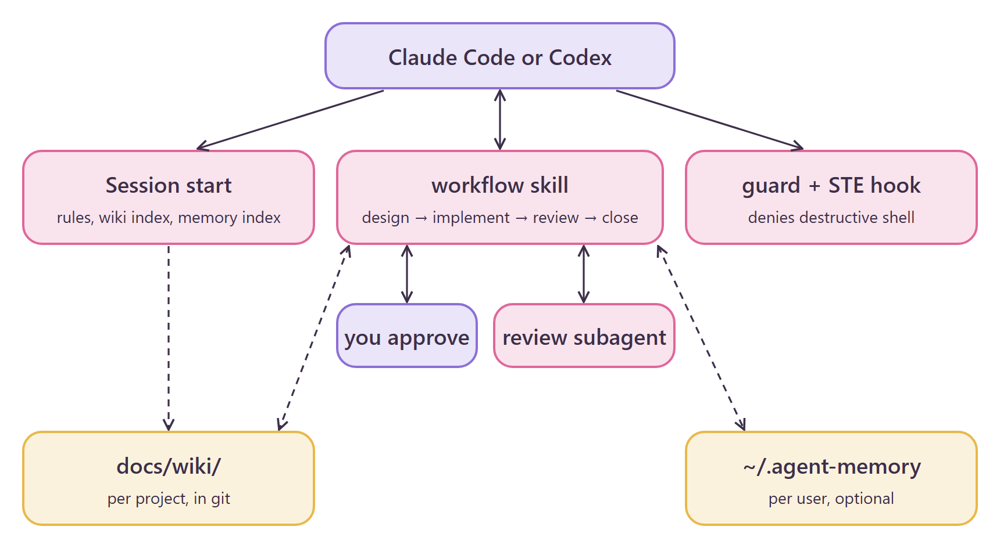

<div align="center">

# ♡ minimal-agent-kit ♡

**A small, token-cheap rule kit that keeps coding agents careful and honest~**

English · [简体中文](README.zh-CN.md) · [繁體中文](README.zh-TW.md)

`minimal-agent-kit` (｡•̀ᴗ-)✧

</div>

## What is this?

`minimal-agent-kit` gives Claude Code and Codex one workflow, one memory model, and one safety net.

- **Rules and skills**: a design, implement, review, and close workflow, with two human approval gates, BDD scenarios, and a Graphviz diagram.
- **Hooks**: a guard that denies destructive shell commands, also in bypass mode, and a check for Simplified Technical English (STE).
- **Checks**: scripts that test the JSON plan and the changed Python and JS code against it. A reusable sandbox tests risky assumptions before you write code.

You see the rules and your project wiki index at the start of each session. Then the agent asks you questions before it writes code.

Guiding question: *what is the minimal amount of code and impact that leads to the solution?*

<p align="center"></p>

## Requirements

- Python 3.9 or later, on `PATH` as `python3` or `python`.
- Graphviz (`dot`), for design diagrams.
- Node 22.13 or later, for the JS checks, the spike sandbox, and the optional `agent-memory` plugin.
- Claude Code, or the Codex app or CLI.

## Install (๑•̀ㅂ•́)و✧

### 1. Add the marketplace (Claude Code)

```bash
claude plugin marketplace add stellarie/minimal-agent-kit
```

Claude Code lists the `minimal-agent-kit` marketplace.

### 2. Install the kit (Claude Code)

```bash
claude plugin install minimal-agent-kit@minimal-agent-kit
```

Restart Claude Code. The session context then starts with `# Agent rules`.

### 3. Install the memory plugin (optional)

```bash
claude plugin install agent-memory@minimal-agent-kit
```

After a restart, the session context shows a memory index. The store is `~/.agent-memory`.

### 4. Install for Codex

Codex needs files copied and a hook added to `~/.codex/config.toml`. Follow [INSTALL.md](INSTALL.md). An agent can run it step by step.

### 5. Set up the spike sandbox (optional, once)

```bash
python tools/sandbox.py <empty-dir>
```

The command needs network access. It prints `sandbox ready: <empty-dir>`. Each task then uses a `spike/<task>` branch there.

## Skills and hooks

| Name | Kind | What it does |
|---|---|---|
| `workflow` | skill | Design, implement, review, close. Each phase has numbered substeps and an output template. |
| `wiki` | skill | Keeps long-term project memory in `docs/wiki/`, with a fixed page format. |
| `ste` | skill | The STE writing rules for chat and files. |
| `verify/` | scripts | Check the plan file and the changed Python and JS code against it, run the project's own check tools, and prove each changed hunk is needed by a test. |
| `tools/sandbox.py` | script | Sets up a reusable spike sandbox (pytest, jest, Express, React) with fault mocks, once. |
| `SessionStart` | hook | Loads the rules and `docs/wiki/index.md`. |
| `PreToolUse` | hook | Runs the guard on each `Bash` and `PowerShell` call. |
| `PostToolUse` | hook | Runs the STE check on each Markdown file the agent writes. |

A round trip with the guard:

```bash
echo '{"tool_name":"Bash","tool_input":{"command":"rm -rf /"}}' | python claude/guard/guard.py; echo "exit=$?"
```

The guard prints a `guard: denied` message and exits with `exit=2`. A safe command, such as `git status`, exits with `exit=0`.

## Safety (｀ω´)ゞ

The kit does not give the agent new power. The guard only removes power. It does not sandbox the agent.

1. The guard splits the command into tokens. It denies `rm` on a dangerous path, `git reset --hard`, `git clean -f`, and a force push to `main`.
2. It matches the full command against the deny patterns in `rules.json`.
3. It checks commands inside `sh -c`, `bash -c`, and similar wrappers again.

The guard matches command text. A script that builds a command at run time can get past it. If Python is missing, the hook fails and Claude Code runs the command anyway.

The review phase sends the diff to a subagent. The author of a change never reviews its own work.

## Configuration

| Setting | Where | Default |
|---|---|---|
| Deny patterns | `core/guard/rules.json` | `mkfs`, `dd` to a device, `drop database`, and others |
| Review model | `core/skills/workflow/review.md` | Opus 5.5 at medium on Claude Code, Sol 6.1 at light on Codex |
| Project wiki | `docs/wiki/` in your project | none, the `wiki` skill creates it |
| Memory store | `AGENT_MEMORY_HOME` | `~/.agent-memory` |

## Develop

Edit only `core/`. Then copy it into the targets:

```bash
python tools/sync.py
```

```bash
python tools/sync.py --check
```

```bash
python -m unittest discover -s tests
```

`tools/vendor_memory.py` generates `memory/`. Do not edit it by hand.

```bash
cd memory && npm test
```

## License

MIT © stellarie. Made with ♡ (≧∀≦)
