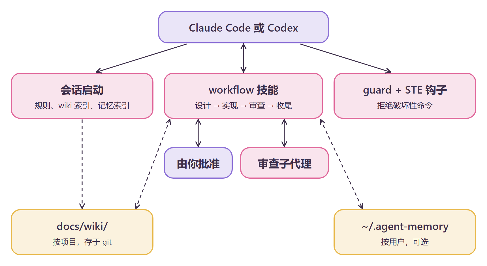

<div align="center">

# ♡ minimal-agent-kit ♡

**一套小巧、省令牌的规则套件，让编程代理谨慎又诚实~**

[English](README.md) · 简体中文 · [繁體中文](README.zh-TW.md)

`minimal-agent-kit` (｡•̀ᴗ-)✧

</div>

## 这是什么？

`minimal-agent-kit` 为 Claude Code 和 Codex 提供一套工作流、一种记忆模型和一张安全网。

- **规则与技能**：设计、实现、审查、收尾的工作流，含两道人工批准关卡、BDD 场景和 Graphviz 图。
- **钩子**：一个拒绝或询问破坏性 shell 命令的 guard（在绕过模式下也有效），以及简化技术英语（STE）检查。
- **检查**：用脚本对照 JSON 计划检查计划本身和改动的 Python、JS 代码。一个可复用的沙箱在写代码前测试有风险的假设。

每个会话开始时，你会看到规则和项目 wiki 索引。之后代理会先向你提问，再写代码。

指导问题：*用最少的代码和影响，怎样达成目标？*

<p align="center"></p>

## 环境要求

- Python 3.9 或更高版本，在 `PATH` 中名为 `python3` 或 `python`。
- Graphviz（`dot`），用于设计图。
- Node 22.18 或更高版本，用于 guard 钩子、JS 检查、spike 沙箱、可选的 `agent-memory` 插件和 lounge 核心。
- Claude Code，或 Codex 应用或 CLI。
- Windows，用于可选的 lounge。

## 安装 (๑•̀ㅂ•́)و✧

### 1. 添加插件市场（Claude Code）

```bash
claude plugin marketplace add stellarie/minimal-agent-kit
```

Claude Code 会列出 `minimal-agent-kit` 插件市场。

### 2. 安装套件（Claude Code）

```bash
claude plugin install minimal-agent-kit@minimal-agent-kit
```

重启 Claude Code。会话上下文会以 `# Agent rules` 开头。

### 3. 安装记忆插件（可选）

```bash
claude plugin install agent-memory@minimal-agent-kit
```

重启后，会话上下文会显示记忆索引。存储位置为 `~/.agent-memory`。

### 4. 为 Codex 安装

Codex 需要复制文件，并在 `~/.codex/config.toml` 中添加钩子。请按照 [INSTALL.md](INSTALL.md) 操作。代理可以逐步执行它。

### 5. 设置 spike 沙箱（可选，一次）

```bash
python tools/sandbox.py <empty-dir>
```

该命令需要网络访问。它输出 `sandbox ready: <empty-dir>`。之后每个任务在其中使用 `spike/<task>` 分支。

### 6. 安装 lounge（可选，Windows）

```bash
python tools/release.py
```

该命令向 `dist/` 写出两个 zip：`minimal-agent-kit-<ver>.zip` 只含套件，`minimal-agent-kit-lounge-<ver>-windows.zip` 含套件和 lounge。请先构建 exe、`lounge/ui/dist` 和 `lounge/core/node_modules`，否则 `release.py` 只写出套件 zip。解压 lounge zip，然后运行 `lounge/agent-lounge.exe`。应用会启动它旁边的核心。构建命令见 [INSTALL.md](INSTALL.md)。

## 技能与钩子

| 名称 | 类型 | 作用 |
|---|---|---|
| `workflow` | 技能 | 设计、实现、审查、收尾。每个阶段都有编号子步骤和输出模板。 |
| `wiki` | 技能 | 在 `$WIKI_ROOT/<name>/` 中保存长期项目记忆；未设置 `WIKI_ROOT` 时在 `docs/wiki/`。页面格式固定。 |
| `ste` | 技能 | 聊天和文件的 STE 写作规则。 |
| `style` | 技能 | 文档、注释和提交信息的语法、标点、行文和用词规则。 |
| `verify/` | 脚本 | 检查计划文件、其中的证明和设计图，按计划检查改动的 Python 和 JS 代码，运行项目自己的检查工具，并证明每个改动块都被某个测试需要。这些脚本还会按 wiki 格式检查 wiki 文件夹。 |
| `tools/sandbox.py` | 脚本 | 一次性搭建可复用的试验沙盒（pytest、jest、Express、React），带故障模拟。 |
| `SessionStart` | 钩子 | 加载规则和 wiki 的 `index.md`。 |
| `PreToolUse` | 钩子 | 对每次 `Bash` 和 `PowerShell` 调用运行 guard。 |
| `PostToolUse` | 钩子 | 对代理写出的每个 Markdown 文件运行 STE 检查。 |

guard 的一次往返：

```bash
echo '{"tool_name":"Bash","tool_input":{"command":"rm -rf /"}}' | node claude/guard/guard.js
```

guard 会输出带有 `"permissionDecision":"deny"` 和原因的 JSON 决定。安全命令（如 `git status`）不输出任何内容，代理保留自己的权限提示。有风险但常见的命令（如 `git clean -fdx`）得到 `"ask"`。

## Lounge (≧∀≦)

lounge 是可选的 Windows 桌面应用。它在聊天线程中运行 Claude Code 和 Codex，并使用同一个 guard。先支持 Windows。Claude Code 和 Codex 是两个运行时。核心需要 Node 22.18 或更高版本。详见 [lounge/docs/architecture.md](lounge/docs/architecture.md)。

| 功能 | 作用 |
|---|---|
| 预置技能 | 首次启动把 `lounge-workflow`、`wiki` 和 `ste` 复制到 `<home>\skills`。你编辑过的技能保持原样。 |
| 工作流插件 | 内置插件 `kit-workflow` 提供完整的 kit 工作流技能和校验脚本。在插件列表中启用。需要 `PATH` 中有 Python 3。 |
| 模型与强度 | 代理编辑器按模型列出你本机 Claude Code 和 Codex 报告的模型与强度，其他名称用 **Custom…** 输入。**Refresh** 重新读取。 |
| 阶段关卡 | 工具 `lounge_gate` 在设计和审查结束时打开“批准”或“修改”卡片。你的决定会唤醒负责的代理。 |
| 黑板 | 只读的 **Board** 标签页显示 `.kit/tasks/` 中的任务文件。 |
| 子线程 | 工具 `lounge_spawn` 为名册中的代理启动子线程。深度上限为 2。停止会传到每个子线程。代理图显示线程树。 |
| 隔离 | 一次会话轮次不加载你自己的技能、插件、`CLAUDE.md` 或 `AGENTS.md`。Codex 使用自己的 `CODEX_HOME`，原生子代理已关闭。 |
| 主题 | 主题选择器可以制作自定义主题。**Export custom themes** 把它们以 JSON 复制到剪贴板。**Import themes** 从粘贴的 JSON 添加主题，总数最多 30 个。 |
| 更新 | lounge 会在 GitHub 上查找用 `lounge/update.pub` 签名的新版本。横幅会先征求你的同意。点击 **Restart to update** 后应用替换安装目录，出错时回滚。你的数据保持不变。`config.json` 中的 `update.check` 可关闭检查。 |
| Codex 登录 | **Sign in to Codex** 登录 lounge 自己的 Codex。lounge 从不复制你的 `auth.json`。 |
| Wiki 面板 | 列出、读取和编辑 wiki 页面。每次保存都会显示 wiki 检查结果。 |
| 自动模式 | 分类器模型判断规则允许的修改类调用。规则的询问始终打开批准卡片。 |

## 安全 (｀ω´)ゞ

套件不会给代理新的权限。guard 只会收回权限，它不是沙箱。

1. guard 把命令拆成词元，逐部分检查。它拒绝这些：
   - 对根目录、主目录或盘符路径执行 `rm`。
   - `git reset --hard`、任何强制推送，以及推送到 `main` 或 `master`。
   - 发给 `psql`、`mysql`、`sqlite3` 或 `sqlcmd` 的 `DROP DATABASE`。
2. 它会询问这些：
   - 在临时文件夹之外执行 `rm -r`，以及 `git clean -f`。
   - `mkfs` 等磁盘工具，以及写入设备的 `dd`。
   - 编码或管道传入的 shell 文本。
   - 读取 `.env`、`.ssh` 等机密文件。
3. 它会再次检查 `sh -c`、`bash -c`、`pwsh -Command` 等包装中的命令。

询问会打开正常的批准提示。在 `-p`、`bypassPermissions` 和 `dontAsk` 模式下无法打开提示，所以 guard 把询问变成拒绝。

guard 匹配的是命令文本。在运行时拼出命令的脚本可以绕过它。如果没有 Node，钩子会失败，Claude Code 仍会执行该命令。

审查阶段把 diff 交给子代理。变更的作者从不审查自己的工作。

## 配置

| 设置 | 位置 | 默认值 |
|---|---|---|
| guard 规则 | `core/guard/rules.js` | shell 命令的拒绝、询问和允许规则 |
| 审查模型 | `core/skills/workflow/review.md` | Claude Code 上为 Opus 5.5（medium），Codex 上为 Sol 6.1（light） |
| 项目 wiki | `WIKI_ROOT`、`WIKI_NAME` | 你项目中的 `docs/wiki/`。设置 `WIKI_ROOT`（绝对路径，或以 `~` 开头）后：`$WIKI_ROOT/<WIKI_NAME 或项目目录名>/`。由 `wiki` 技能创建 |
| 记忆存储 | `AGENT_MEMORY_HOME` | `~/.agent-memory` |
| lounge 主目录 | `AGENT_LOUNGE_HOME` | `%USERPROFILE%\.agent-lounge` |

`WIKI_NAME` 是纯文件夹名称，不是路径。会话钩子使用 `WIKI_NAME`，或会话启动时所在目录的名称。

## 开发

只编辑 `core/`。然后复制到各目标：

```bash
python tools/sync.py
```

```bash
python tools/sync.py --check
```

```bash
python -m unittest discover -s tests
```

`tools/vendor_memory.py` 生成 `memory/`。请勿手动编辑。

```bash
cd memory && npm test
```

```bash
cd lounge/core && npm test
```

## 许可证

MIT © stellarie. Made with ♡ (≧∀≦)
