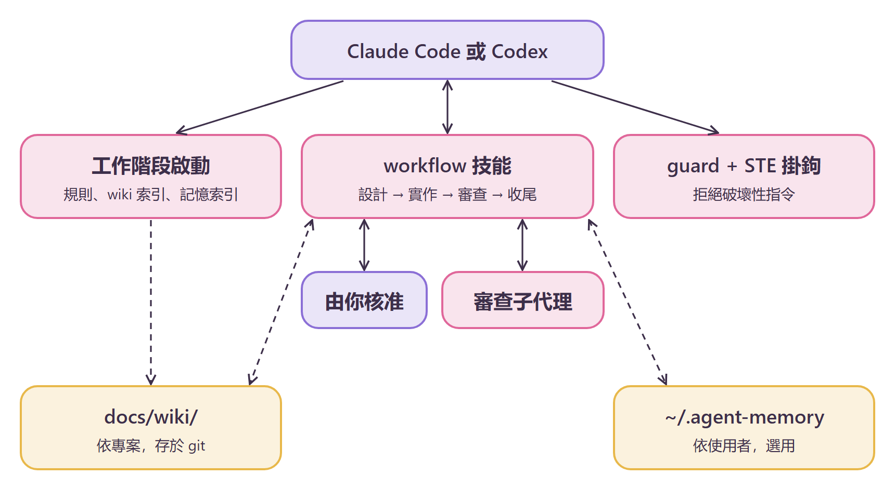

<div align="center">

# ♡ minimal-agent-kit ♡

**一套小巧、省權杖的規則套件，讓程式代理謹慎又誠實~**

[English](README.md) · [简体中文](README.zh-CN.md) · 繁體中文

`minimal-agent-kit` (｡•̀ᴗ-)✧

</div>

## 這是什麼？

`minimal-agent-kit` 為 Claude Code 和 Codex 提供一套工作流程、一種記憶模型和一張安全網。

- **規則與技能**：設計、實作、審查、收尾的工作流程，含兩道人工核准關卡、BDD 情境和 Graphviz 圖。
- **掛鉤**：一個拒絕破壞性 shell 指令的 guard（在略過模式下也有效），以及簡化技術英文（STE）檢查。

每個工作階段開始時，你會看到規則和專案 wiki 索引。之後代理會先向你提問，再寫程式碼。

指導問題：*用最少的程式碼和影響，怎樣達成目標？*

<p align="center"></p>

## 環境需求

- Python 3.9 或更新版本，在 `PATH` 中名為 `python3` 或 `python`。
- Graphviz（`dot`），用於設計圖。
- Node 22.13 或更新版本，僅選用的 `agent-memory` 外掛需要。
- Claude Code，或 Codex 應用程式或 CLI。

## 安裝 (๑•̀ㅂ•́)و✧

### 1. 新增外掛市集（Claude Code）

```bash
claude plugin marketplace add stellarie/minimal-agent-kit
```

Claude Code 會列出 `minimal-agent-kit` 外掛市集。

### 2. 安裝套件（Claude Code）

```bash
claude plugin install minimal-agent-kit@minimal-agent-kit
```

重新啟動 Claude Code。工作階段內容會以 `# Agent rules` 開頭。

### 3. 安裝記憶外掛（選用）

```bash
claude plugin install agent-memory@minimal-agent-kit
```

重新啟動後，工作階段內容會顯示記憶索引。儲存位置為 `~/.agent-memory`。

### 4. 為 Codex 安裝

Codex 需要複製檔案，並在 `~/.codex/config.toml` 中新增掛鉤。請依照 [INSTALL.md](INSTALL.md) 操作。代理可以逐步執行它。

## 技能與掛鉤

| 名稱 | 類型 | 作用 |
|---|---|---|
| `workflow` | 技能 | 設計、實作、審查、收尾。每個階段都有編號子步驟和輸出範本。 |
| `wiki` | 技能 | 在 `docs/wiki/` 中保存長期專案記憶，頁面格式固定。 |
| `ste` | 技能 | 聊天和檔案的 STE 寫作規則。 |
| `verify/` | 腳本 | 檢查計畫檔，依計畫檢查變更的 Python 和 JS 程式碼，並執行專案自己的檢查工具。 |
| `tools/sandbox.py` | 腳本 | 一次性建立可重複使用的試驗沙盒（pytest、jest、Express、React），附故障模擬。 |
| `SessionStart` | 掛鉤 | 載入規則和 `docs/wiki/index.md`。 |
| `PreToolUse` | 掛鉤 | 對每次 `Bash` 和 `PowerShell` 呼叫執行 guard。 |
| `PostToolUse` | 掛鉤 | 對代理寫出的每個 Markdown 檔案執行 STE 檢查。 |

guard 的一次往返：

```bash
echo '{"tool_name":"Bash","tool_input":{"command":"rm -rf /"}}' | python claude/guard/guard.py; echo "exit=$?"
```

guard 會輸出 `guard: denied` 訊息，並以 `exit=2` 結束。安全指令（如 `git status`）以 `exit=0` 結束。

## 安全 (｀ω´)ゞ

套件不會給代理新的權限。guard 只會收回權限，它不是沙箱。

1. guard 把指令拆成詞元。它拒絕對危險路徑執行 `rm`、`git reset --hard`、`git clean -f`，以及強制推送到 `main`。
2. 它用 `rules.json` 中的拒絕模式比對整條指令。
3. 它會再次檢查 `sh -c`、`bash -c` 等包裝中的指令。

guard 比對的是指令文字。在執行時拼出指令的指令碼可以繞過它。如果沒有 Python，掛鉤會失敗，Claude Code 仍會執行該指令。

審查階段把 diff 交給子代理。變更的作者從不審查自己的工作。

## 設定

| 設定 | 位置 | 預設值 |
|---|---|---|
| 拒絕模式 | `core/guard/rules.json` | `mkfs`、寫入裝置的 `dd`、`drop database` 等 |
| 審查模型 | `core/skills/workflow/review.md` | Claude Code 上為 Opus 5.5（medium），Codex 上為 Sol 6.1（light） |
| 專案 wiki | 你專案中的 `docs/wiki/` | 無，由 `wiki` 技能建立 |
| 記憶儲存區 | `AGENT_MEMORY_HOME` | `~/.agent-memory` |

## 開發

只編輯 `core/`。然後複製到各目標：

```bash
python tools/sync.py
```

```bash
python tools/sync.py --check
```

```bash
python -m unittest discover -s tests
```

`tools/vendor_memory.py` 產生 `memory/`。請勿手動編輯。

```bash
cd memory && npm test
```

## 授權

MIT © stellarie. Made with ♡ (≧∀≦)
