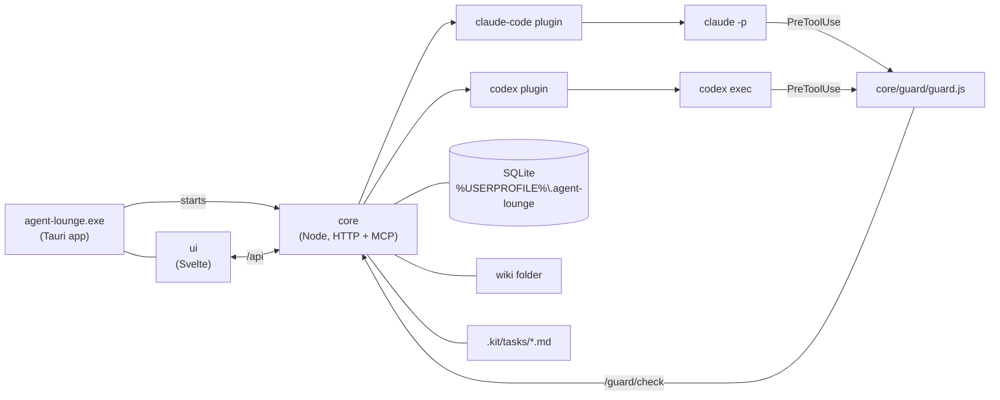
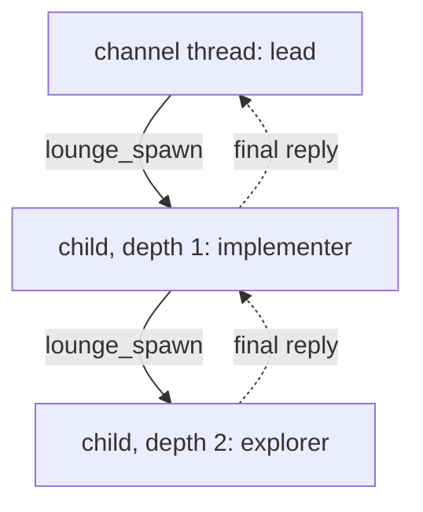
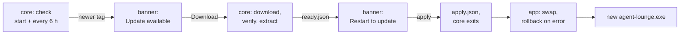

# Lounge architecture

The lounge is a Windows desktop app. It runs Claude Code and Codex in chat threads. It needs Node 22.18 or later, because the core runs `node src/main.ts` with type stripping.

## Parts

| Part | Folder | Job |
|---|---|---|
| App | `lounge/app` | Starts the core from `core/` beside the exe. Shows the UI. |
| Core | `lounge/core` | Keeps threads, roster, schedules, approvals, and the SQLite store. Serves `/api/...`, `/guard/check`, and the MCP tools. |
| UI | `lounge/ui` | Channels, threads, approval cards, and side tabs. |
| Plugins | `lounge/plugins` | One per runtime: `claude-code` and `codex`. A plugin runs one turn and reads its events. `kit-workflow` adds the kit workflow skill. |
| Guard | `core/guard` | The kit guard. One engine for the kit and the lounge. |
| Skills | `lounge/skills` | Seed skills. |

## Turn

1. A post starts a turn for an agent.
2. The context builder joins the agent file, the project `AGENTS.md` or `CLAUDE.md`, the wiki `index.md`, the skill list, and the lounge rules. It writes no file.
3. The plugin runs the runtime with the isolation settings.
4. Each shell or file call runs the guard hook first.
5. The core posts the final reply into the thread.

## Guard and approvals

- Inside a lounge turn, `guard.js` denies a call that the rules block.
- It sends every other call to `/guard/check`. The core decides. A core that does not answer gives a deny.
- A tool mode sets what the core does with the call: `read-only`, `ask`, `auto`, or `full`.
- A rule that asks opens an approval card. The owner decides.
- In `auto` mode, a classifier judges a mutating call that the rules allow. A listed model must answer `SAFE`. Any other answer, a timeout, or a failure opens a card.
- A block verdict never becomes an allow.

## Seeded skills

On the first start, the core copies `lounge/skills/{lounge-workflow,wiki,ste}` to `<home>\skills`. The core never overwrites a folder that exists. The context lists the name and description of each skill. The `lounge_skill` tool returns a body. A post with `$name` attaches that body.

| Skill | Use |
|---|---|
| `lounge-workflow` | Design, implement, review, and close. It maps gates to `lounge_gate`, workers to `lounge_spawn`, and tasks to the blackboard. |
| `wiki` | Reads and writes the project wiki. |
| `ste` | Writes Simplified Technical English. |

## Models and efforts

Each runtime plugin reads its model list when it loads, and again on **Refresh**.

- Claude Code: the newest `*-cc.json` in `~/.claude/cache/model-catalog`, without the masked ids. If the folder is empty, the efforts come from `claude --help`.
- Codex: `codex debug models` with the lounge `CODEX_HOME`. If it fails, `models_cache.json` of that folder.
- The efforts of an agent are the efforts of its model. An empty or typed model gets all efforts of the catalog.
- Codex gets `-c model_reasoning_effort=<effort>` on every turn, a resumed turn too. A resumed thread gets the full context again when the lounge rules changed.
- A plugin setup function gets `api.home`, the lounge home folder.

## Plugin skills

An enabled plugin can supply skills. `plugin.json` has `skills` (skill name to folder) and `vars` (name to folder). Paths are relative to the plugin folder.

- The context lists a plugin skill with the others.
- Its body has each `$NAME` of `vars` replaced by an absolute path. It ends with the folder of the skill files.
- A plugin skill is read-only.
- A skill in `<home>\skills` with the same name hides it.
- A plugin in `<home>\plugins` may not point outside its own folder. A bundled plugin may.

## Phase gates

`lounge_gate {phase, summary, file}` opens a card with Approve and Change in the approval stack.

- A decision posts into the thread and mentions the lead. The mention starts the lead's turn.
- A gate accepts one decision. A second decision gets HTTP 409.
- A decision on a stopped thread posts a line and starts no turn.
- The thread header shows the phase.

## Blackboard

The **Board** side tab shows `<thread folder>/.kit/tasks/*.md`. It reads and never writes. It polls every 5 seconds. A task file that does not parse shows as raw text with a warning. A missing folder shows an empty board.

## Child threads

`lounge_spawn {agent, brief, cwd?}` makes a child thread. The lead of the child is the named agent. The agent must be in the roster.

- The depth cap is 2 below a channel thread. A deeper spawn returns `depth cap`.
- When the lead of a child ends a turn with no pending turn, the core posts the final reply into the parent. It mentions the spawner.
- After you spawn, end your turn. Do not poll. The final reply of the child wakes you.
- A stop cascades to every descendant. A stopped child never resumes. Stop marks live in memory, so they hold for one core run.
- The agent graph tab shows the thread tree with live status.
- Native subagents are off, so each child shows in the graph. Claude runs with `--disallowedTools=Task,Agent,Workflow`. A Codex hook denies every `collaboration*_agent` tool, and `collaborationsend_input` and `collaborationsend_message`.

## Harness isolation

A lounge turn sees only lounge skills and the files that the context builder inserts.

| Runtime | Isolation |
|---|---|
| Claude Code | `--setting-sources project,local`, `--strict-mcp-config` with the lounge MCP server, a lounge settings file, `--disable-slash-commands`, and `CLAUDE_CODE_DISABLE_CLAUDE_MDS=1`. The settings file holds the guard hook and the `CLAUDE.md` excludes. The lounge never uses `--bare`, because it skips hooks and OAuth. |
| Codex | `CODEX_HOME` is `codex-home` in the lounge home, with `cli_auth_credentials_store="file"`. Your `~/.codex` skills and `AGENTS.md` do not load. The guard hook is passed with `-c hooks.PreToolUse=...`. See [codex/hooks.md](../../codex/hooks.md). |

- The lounge never copies `auth.json` from your Codex folder. A refresh token that rotates in one folder can break the other login.
- **Sign in to Codex** in the app runs `codex login` once with the lounge `CODEX_HOME`. A turn without a login stops with a clear error.
- The Claude hook matcher covers `Bash`, `PowerShell`, `Write`, `Edit`, `MultiEdit`, `NotebookEdit`, `Read`, `Glob`, and `Grep`. The Codex hook matcher is `^Bash$`.

## Update

The lounge finds a newer release on GitHub, asks you, and swaps the install on restart. It never updates by itself.

1. **Check.** The core asks `releases/latest` of the kit repository at start and every 6 hours. A tag `v<major>.<minor>.<patch>` that is greater than the installed version makes the state `available`. A 404 means no release. The config key `update.check` turns the check off. The default is `true`.
2. **Download.** **Download** in the banner starts it. The core fetches `minimal-agent-kit-lounge-<ver>-windows.zip` and its `.minisig` file.
3. **Verify.** The core checks a minisign signature with `lounge/update.pub` of the installed lounge. The key must make a prehashed (`ED`) signature. The trusted comment must verify too. Any failure stops the update and removes the staged files. The core uses only `node:crypto`.
4. **Stage.** `tar.exe` extracts the zip into `<home>\updates\<ver>\root`. The staged `lounge/core/package.json` must hold the same version as the tag. The core then writes `ready.json`. Before it stages, the core removes every other entry under `<home>\updates`, so old staged copies do not pile up. These files are the only writes of the core into the lounge home for an update.
5. **Apply.** **Restart to update** calls `POST /api/update/apply`. Only the owner token may call it. The core writes `<home>\updates\apply.json` and exits.
6. **Swap.** The app finds the marker and deletes it first, so a failed swap cannot repeat. The app refuses a marker whose version is not `N.N.N`. The app copies the staged root to `<install>\.new\<ver>`. It then moves each top-level entry of the staged root into the install, and the old entry into `<install>\.old\<time>`. The app starts the new `agent-lounge.exe` and exits.
7. **Rollback.** If one move fails, the app moves every entry back, shows the error, and keeps the old core running. If a move back fails, the app logs the stuck paths, writes `.old\rollback-incomplete`, and shows "rollback incomplete" instead of "rolled back".
8. **Cleanup.** The next start removes `.old` and `.new`, unless `.old\rollback-incomplete` exists. Then both stay for a manual repair. A locked `.old` stays until a later start. The app also sets its working folder to the lounge home, so the install folder can move.

A build from source, not from the zip, does not swap. The app refuses when its folder is not `lounge/` with `core/src/main.ts` beside it. Your data in the lounge home stays as it was.

To publish a release:

1. Make a key pair once: `minisign -G -p lounge/update.pub -s <secret key path>`. Commit `lounge/update.pub`. Keep the secret key outside the repository.
2. Build the exe, `lounge/ui/dist`, and `lounge/core/node_modules`. Raise the version in every manifest. `tests/test_versions.py` checks that they match.
3. Run `python tools/release.py --publish --key <secret key path>`. It writes both zips, signs each with minisign, and runs `gh release create v<ver>` with the zips and the `.minisig` files. It stops before any command when `lounge/update.pub` is not tracked.

A new key needs a manual install, because the installed `update.pub` verifies each update.

## Wiki

The wiki panel lists, reads, and edits pages in the wiki folder. The folder rule matches the kit session hook. Each save returns the `wiki_check.py` findings. A finding that did not run, such as a missing `python`, shows as `not-run`.
