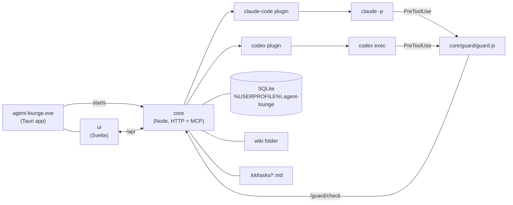
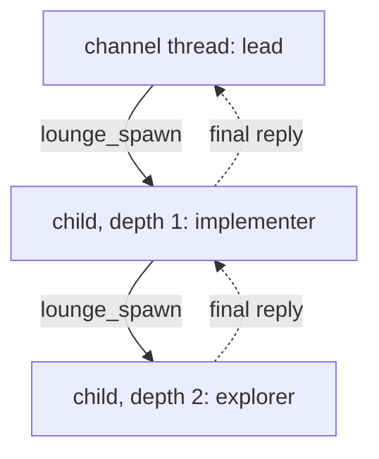

# Lounge architecture

The lounge is a Windows desktop app. It runs Claude Code and Codex in chat threads. It needs Node 22.18 or later, because the core runs `node src/main.ts` with type stripping.

## Parts

| Part | Folder | Job |
|---|---|---|
| App | `lounge/app` | Starts the core from `core/` beside the exe. Shows the UI. |
| Core | `lounge/core` | Keeps threads, roster, schedules, approvals, and the SQLite store. Serves `/api/...`, `/guard/check`, and the MCP tools. |
| UI | `lounge/ui` | Channels, threads, approval cards, and side tabs. |
| Plugins | `lounge/plugins` | One per runtime: `claude-code` and `codex`. A plugin runs one turn and reads its events. |
| Guard | `core/guard` | The kit guard. One engine for the kit and the lounge. |
| Skills | `lounge/skills` | Seed skills. |

## Turn

1. A post starts a turn for an agent.
2. The context builder joins the agent file, the project `AGENTS.md` or `CLAUDE.md`, the wiki `index.md`, the skill list, and the lounge rules. It writes no file.
3. The plugin runs the runtime with the isolation settings.
4. Each shell or file call runs the guard hook first.
5. The core posts the final reply into the thread.

## Guard and approvals

- Inside a lounge turn, `guard.js` denies a call that the rules block.
- It sends every other call to `/guard/check`. The core decides. A core that does not answer gives a deny.
- A tool mode sets what the core does with the call: `read-only`, `ask`, `auto`, or `full`.
- A rule that asks opens an approval card. The owner decides.
- In `auto` mode, a classifier judges a mutating call that the rules allow. A listed model must answer `SAFE`. Any other answer, a timeout, or a failure opens a card.
- A block verdict never becomes an allow.

## Seeded skills

On the first start, the core copies `lounge/skills/{lounge-workflow,wiki,ste}` to `<home>\skills`. The core never overwrites a folder that exists. The context lists the name and description of each skill. The `lounge_skill` tool returns a body. A post with `$name` attaches that body.

| Skill | Use |
|---|---|
| `lounge-workflow` | Design, implement, review, and close. It maps gates to `lounge_gate`, workers to `lounge_spawn`, and tasks to the blackboard. |
| `wiki` | Reads and writes the project wiki. |
| `ste` | Writes Simplified Technical English. |

## Phase gates

`lounge_gate {phase, summary, file}` opens a card with Approve and Change in the approval stack.

- A decision posts into the thread and mentions the lead. The mention starts the lead's turn.
- A gate accepts one decision. A second decision gets HTTP 409.
- A decision on a stopped thread posts a line and starts no turn.
- The thread header shows the phase.

## Blackboard

The **Board** side tab shows `<thread folder>/.kit/tasks/*.md`. It reads and never writes. It polls every 5 seconds. A task file that does not parse shows as raw text with a warning. A missing folder shows an empty board.

## Child threads

`lounge_spawn {agent, brief, cwd?}` makes a child thread. The lead of the child is the named agent. The agent must be in the roster.

- The depth cap is 2 below a channel thread. A deeper spawn returns `depth cap`.
- When the lead of a child ends a turn with no pending turn, the core posts the final reply into the parent. It mentions the spawner.
- A stop cascades to every descendant. A stopped child never resumes. Stop marks live in memory, so they hold for one core run.
- The agent graph tab shows the thread tree with live status.
- Native subagents are off, so each child shows in the graph. Claude runs with `--disallowedTools=Task,Workflow`. A Codex hook denies the `collaborationspawn_agent` tool.

## Harness isolation

A lounge turn sees only lounge skills and the files that the context builder inserts.

| Runtime | Isolation |
|---|---|
| Claude Code | `--setting-sources project,local`, `--strict-mcp-config` with the lounge MCP server, a lounge settings file, `--disable-slash-commands`, and `CLAUDE_CODE_DISABLE_CLAUDE_MDS=1`. The settings file holds the guard hook and the `CLAUDE.md` excludes. The lounge never uses `--bare`, because it skips hooks and OAuth. |
| Codex | `CODEX_HOME` is `codex-home` in the lounge home, with `cli_auth_credentials_store="file"`. Your `~/.codex` skills and `AGENTS.md` do not load. The guard hook is passed with `-c hooks.PreToolUse=...`. See [codex/hooks.md](../../codex/hooks.md). |

- The lounge never copies `auth.json` from your Codex folder. A refresh token that rotates in one folder can break the other login.
- **Sign in to Codex** in the app runs `codex login` once with the lounge `CODEX_HOME`. A turn without a login stops with a clear error.
- The Claude hook matcher covers `Bash`, `PowerShell`, `Write`, `Edit`, `MultiEdit`, `NotebookEdit`, `Read`, `Glob`, and `Grep`. The Codex hook matcher is `^Bash$`.

## Wiki

The wiki panel lists, reads, and edits pages in the wiki folder. The folder rule matches the kit session hook. Each save returns the `wiki_check.py` findings. A finding that did not run, such as a missing `python`, shows as `not-run`.
